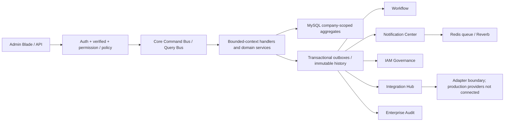
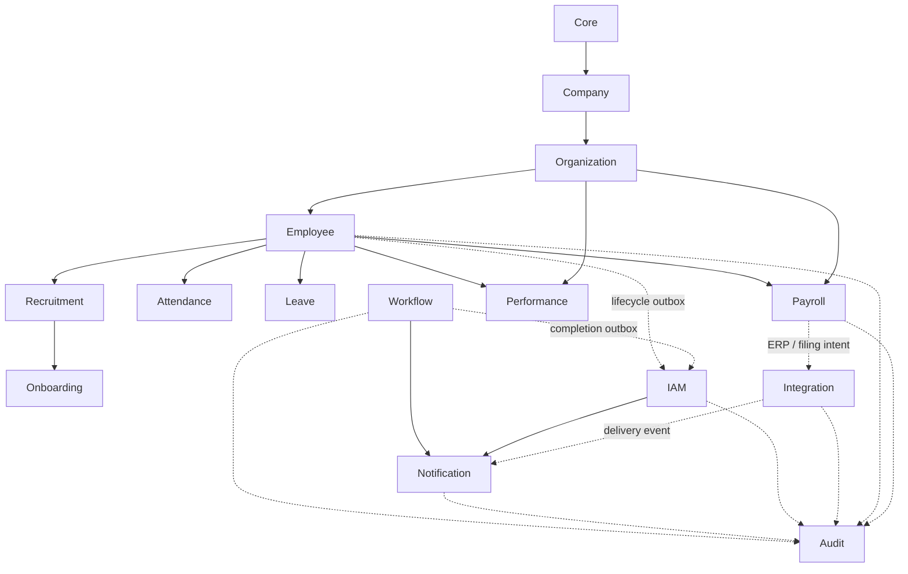

# Enterprise Final Review

Audit date: 2026-08-09  
Scope: read-only architecture, source code, routes, migrations, permissions, tenant boundaries, production baseline and documentation. No migration, business-logic change, seed or database write was performed.

## Executive summary

The project is a broad Laravel 13 modular enterprise HR platform with a shared CQRS bus, company tenant boundary, Spatie runtime authorization, immutable snapshots/history, transactional outboxes, Redis queues/cache, Reverb and private artifact handling. The most mature bounded contexts are Organization and the enterprise platform layers added in Phase 3F: Workflow, Notification, IAM, Integration and Audit. Phase 3F-6 subsequently closed the environment, Git, module dependency, route and static-analysis governance risks identified by this review; its evidence is recorded in `docs/phase-3f-6-production-readiness.md`.

The final review does **not** classify the whole product as finished. Employee Core, Recruitment/Onboarding, workforce operations and the full Payroll product retain explicitly documented functional gaps or external integrations. Several disabled modules remain catalog/skeleton only.

No source-code defect was changed. Two high-priority operational risks require action before a real production deployment:

1. The current runtime reports `APP_ENV=local` and `APP_DEBUG=true` while connected to `mysql/schema_admin`. Although browser fixtures also require a `*_testing` database and therefore reject this database, debug/local mode against production-shaped data is unsafe.
2. The entire working tree appears untracked (`git status --short` reports project files as `??`). Until the repository baseline is committed and reproducible, CI/CD, change review, rollback and provenance cannot be trusted.

## 1. Completed modules and truthful scope

### Completed bounded contexts or completed foundation phases

| Context | Review status | Evidence/qualification |
|---|---|---|
| Core | Functional | Shared Command Bus and Query Bus bindings. |
| Company | Completed vertical slice | CQRS CRUD, policy, permissions, tenant-aware UI and tests. |
| Organization | Completed Organization Core | Cost centers, units/tree, positions, headcount and exports. |
| Workflow | Completed foundation | Versioned definition/instance/task engine, histories and outbox. |
| Notification | Completed foundation | Template/version, message, recipient, delivery attempts, preferences and outbox. |
| IAM | Completed governance foundation | Access request, SoD, privileged approval, certification, Spatie adapter and integrations. |
| Integration | Completed hub foundation | Connections, outbound/inbound, webhook, attempts, dead letters and domain bridges. |
| Audit | Completed platform foundation | Six source consumers, checkpoints, immutable snapshots, streaming exports and archives. |
| Performance | Completed implemented phases | Talent performance, career/succession and workforce analytics foundations are enabled. |

### Enabled but not globally complete

| Context | Remaining scope recorded by the project |
|---|---|
| Employee | Credential/signed-contract evidence actions, renewal, consent evidence, create-user/disable-access and some import/avatar work remain incomplete. |
| Recruitment / Onboarding | Core requisition, candidate, interview, offer, hire and onboarding flows exist; external delivery/calendar, candidate portal and some richer reporting remain deferred. |
| Attendance / Leave | Internal workforce workflows are mature; external scanner/device integrations and some operational extensions remain deferred. |
| Payroll | Many foundations are implemented (period/input/run, insurance, PIT, payslip, payment, accounting, adjustment, annual tax, ERP and government filing), but documentation still correctly treats the full Payroll product and real external/legal execution as partial/foundation-only. |
| Dashboard | Query-side dashboard exists, but it aggregates several domains and requires performance/tenant review at scale. |

### Disabled catalog/skeleton modules

Article, ArticleCategory, Benefit, Contract, Document, Insurance, LaborRelation, Media, Menu, Offboarding, Page, Position, Product, ProductCategory, Report, Security, SEO, Setting, Shift, Succession, System, Tax and Training are disabled as standalone modules. Some business capabilities with these names are implemented inside enabled bounded contexts; module names therefore must not be interpreted as independent completed products.

## 2. Architecture overview

Write paths generally follow Request → Controller → Command Bus → Handler → Domain Service/Repository → transaction → history/outbox. Read paths generally follow Controller → Query Bus → Handler → read repository → typed DTO/ViewModel → Blade/API.

The architecture is pragmatic rather than a strict clean-architecture implementation: newer modules follow CQRS strongly, while several domain services use Laravel's DB facade directly. That is acceptable as an infrastructure choice only when the boundary remains inside the handler/service and company scope is explicit.

## 3. Dependency map

Important finding: every `module.json` currently has an empty `requires` list. The dependency graph therefore exists only in PHP imports, shared database contracts and documentation. The module loader cannot validate boot order or prevent an enabled consumer from depending on a disabled provider. This is a material maintainability risk.

Cross-context coupling is concentrated in:

- `Core`: shared buses.
- `Organization`: tenant access, structure and spreadsheet sanitation consumed by Employee/Payroll.
- `Employee`: identity and lifecycle source for Attendance, Leave, Payroll, Performance and IAM.
- `Payroll`: large aggregate of payroll, tax, insurance, payment, accounting, ERP and filing foundations.
- Enterprise outbox consumers: Workflow/Employee → IAM; Workflow/IAM → Notification; ERP/Government → Integration; six enterprise sources → Audit.

## 4. CQRS consistency

- 104 controller files were inventoried; 59 explicitly inject a Command Bus or Query Bus.
- Direct database/Eloquent query usage was found in three controllers:
  - `app/Http/Controllers/ArticleController.php` — legacy Article read/write bypasses CQRS.
  - `app/Http/Controllers/Api/ArticleController.php` — legacy direct Eloquent reads.
  - `Modules/Integration/app/Presentation/Http/Controllers/IntegrationController.php` — direct `company_user_access` lookup in `context()` rather than a tenant policy/service.
- Dynamic workforce, leave and overtime routes without a static permission middleware perform Gate/Policy authorization in their controllers. This is functionally protected, but the permission matrix is harder to audit than one explicit middleware per route/action.
- Several controllers intentionally group multiple actions into one endpoint and select the command/ability dynamically. This reduces route count but weakens static traceability and makes OpenAPI/security review harder.

Conclusion: CQRS is consistent in the newer enterprise contexts and core HR vertical slices, but not repository-wide. The Article legacy layer and Integration tenant lookup are explicit exceptions.

## 5. Event and outbox flow

Persisted outboxes exist for Workflow, Notification, IAM, Integration, Audit, Employee Lifecycle, Talent Management, Career and Analytics. Consumers use row locks, idempotency keys, published/consumed timestamps or dedicated checkpoint uniqueness depending on context.

Strengths:

- Business state and delivery state are separated.
- Audit has a DB-backed `(source_module, source_event_id, consumer_name)` checkpoint.
- IAM provisioning is isolated behind `SpatieAccessProvisioningAdapter`.
- Immutable histories/checksums and process-level race tests exist in the newest contexts.

Risks:

- There is no single shared outbox envelope, status vocabulary, retry policy or consumer registry. Each context implements its own columns and polling semantics.
- Payroll has no dedicated common outbox for Audit; Audit consumes selected Spatie activity rows as the authoritative event source.
- Multiple scheduled pollers can increase lock contention and operational complexity as volume grows.
- Cross-module PHP imports and cross-table reads mean outbox decoupling is incomplete at build-time even when runtime delivery is asynchronous.

## 6. Permission matrix and tenant isolation

Route inventory:

- 405 admin routes.
- 401 routes have `Authenticate` and `EnsureEmailIsVerified` middleware.
- 375 routes have an explicit Spatie permission middleware.
- 26 authenticated routes rely on controller Gate/Policy authorization rather than route permission middleware.
- Four unauthenticated fixture-login routes exist. Each aborts unless the environment is local/testing **and** the database name ends in `_testing`; they return 404 against `schema_admin`.

Production-shaped authorization metadata currently contains 14 roles, 745 permissions and one company-user access row. Permission prefixes cover 63 functional groups. Spatie remains the runtime authorization source; IAM governs assignment decisions.

Tenant isolation is generally enforced through `company_id`, tenant access services, policies, scoped repositories, or explicit company-user access checks. Foreign-company tests are extensively documented for newer contexts. Remaining concerns:

- Company context often arrives as a request parameter; correctness depends on every entry point invoking its tenant service/policy.
- The Integration controller performs the tenant lookup itself, creating a duplicated authorization boundary.
- Dynamic action endpoints should retain exhaustive permission/state tests because middleware alone cannot express their action-specific rules.

## 7. Security review

### Effective controls

- Authenticated and verified admin boundary.
- Spatie permissions plus record policies/Gates.
- Company isolation and 404 behavior for foreign records in mature contexts.
- Maker-checker/SoD in Payroll, IAM and governed approval flows.
- Private file storage with UUID reference, MIME, size, checksum and signature validation.
- Restricted-field redaction in Audit and safe Notification/Integration payloads.
- Encrypted/referenced credentials rather than plaintext secrets.
- Idempotency and row-locking for critical state transitions.

### Findings

| Severity | Finding | Impact |
|---|---|---|
| High | Application is currently `local` with debug enabled while connected to `schema_admin`. | Debug output and developer tooling may expose internals or enable unsafe operational behavior. |
| High | Working tree has no tracked baseline visible to Git. | No reliable code provenance, peer review, rollback or trustworthy CI source. |
| Medium | Four fixture login routes are always registered, although runtime guards block non-testing DBs. | Defense depends on environment/database-name checks; conditional route registration would reduce attack surface. |
| Medium | 26 admin routes lack explicit permission middleware and depend on dynamic Gate checks. | Harder static auditing; a future controller regression could expose an action. Current inspected controllers do authorize. |
| Medium | Integration controller directly queries tenant access. | Duplicated tenant logic can drift from the canonical policy/service. |
| Medium | CI default PHPStan configuration analyses only `app`; module/test level-10 checks are not part of the shown generic CI command. | New module regressions can pass CI unless a dedicated command is added. |
| Low | Permission catalog has 745 entries across 63 prefixes, including metadata for disabled modules. | Governance/review burden and risk of stale entitlements. |

No confirmed current cross-tenant data leak or plaintext credential exposure was found in this review.

## 8. Database migration inventory and production safety

- 60 migration files were found.
- All 60 report `Ran`.
- Latest architecture batches: Workflow 49, Notification 50, IAM 51–52, Integration 53, Audit 54–55.
- No migration was created or modified during this review.

Read-only `mysql/schema_admin` baseline:

| Table | Rows |
|---|---:|
| employees | 9 |
| payroll_runs | 0 |
| iam_access_requests | 0 |
| workflow_instances | 0 |
| notification_deliveries | 0 |
| integration_outbound_messages | 0 |
| audit_events | 0 |
| audit_exports | 0 |
| audit_archive_artifacts | 0 |
| audit_source_checkpoints | 0 |
| roles | 14 |
| permissions | 745 |
| company_user_access | 1 |

This review performed no seed, insert, update, delete, fixture, migration or external request.

## 9. Performance risks

1. Payroll is a very large bounded context and carries many read/write paths, snapshots, histories and reports. Its long-term scaling risk is higher than the newer smaller enterprise modules.
2. Dashboard aggregation executes multiple domain counts and activity queries per request. Redis caching exists elsewhere, but the inspected dashboard repository should be load-tested with large tenant data.
3. Many services use multiple DB-facade calls and cross-table aggregates. Indexes exist in successive optimization migrations, but representative production-scale `EXPLAIN` evidence is not centralized.
4. Scheduled polling of multiple outboxes can create repeated empty queries and lock contention. Operational metrics, lag and dead-letter alerts should be unified.
5. Tree/headcount, workforce analytics and compliance exports need ongoing bounded-memory/N+1 regression gates. Audit streaming export is a good reference implementation.
6. Reverb, Horizon, Redis, Scheduler and PHP-FPM are separate runtime processes; missing one can leave core HTTP healthy while async business delivery is stalled.

## 10. Documentation consistency

The newest Phase 3F documents are detailed and consistent with their final status. Older phase documents intentionally preserve historical snapshots, but several files contain a stale early `PARTIAL` paragraph followed later by a `COMPLETED` paragraph. Examples include HR Data Governance and Annual Tax reconciliation documents.

Other truthful but easily misunderstood statements remain:

- Employee Core is not globally complete.
- Full Payroll remains partial even though many subphases are completed.
- Some older files still say Tax/Insurance/Payslip/Accounting were not started or connected at that historical checkpoint.
- `project.txt`, `db.txt` and `luong.txt` are cumulative logs, not canonical current-state specifications.

Recommendation: add one generated current-state matrix and mark historical reports explicitly as immutable phase evidence. Do not rewrite historical evidence to imply capabilities existed earlier.

## 11. Remaining technical debt

### Priority 0 — before production deployment

- Separate production configuration and secrets from local development; enforce `APP_ENV=production`, `APP_DEBUG=false`, secure cookies/HTTPS and a production-only deployment check.
- Establish and commit a clean Git baseline; make CI run from that exact revision.

### Priority 1

- Declare real module dependencies or introduce an architecture test that validates allowed imports and boot order.
- Make module/test PHPStan level 10 part of standard CI rather than relying on `paths: [app]`.
- Normalize permission middleware/action policy mapping, especially dynamic workforce and transition endpoints.
- Move Integration tenant resolution to the canonical policy/tenant service.
- Refactor legacy Article controllers into the shared CQRS architecture if CMS is re-enabled.
- Define a common outbox envelope, observability metrics, lag alert and dead-letter operating procedure.

### Priority 2

- Consolidate the 745-permission catalog and formally retire entitlements for disabled modules.
- Publish one authoritative module capability/status manifest generated from routes, migrations and tests.
- Add architecture tests for forbidden cross-module imports and direct database access from controllers.
- Raise CI coverage above the current minimum 20% using risk-based thresholds for Payroll, IAM, Integration and Audit.
- Add production-scale query plans and SLO dashboards for dashboard, payroll reports, analytics and outbox consumers.

## 12. Recommended next phase

Do **not** begin another business module yet. The recommended next phase is an **Enterprise Production Readiness and Architecture Governance Gate**, focused on:

1. environment/secrets hardening and deployment guardrails;
2. establishing the Git/CI release baseline;
3. machine-enforced module dependency rules;
4. full repository PHPStan and permission/route architecture tests;
5. unified outbox operations, health, lag and dead-letter monitoring;
6. canonical current-state documentation and production runbooks;
7. performance/load testing against realistic tenant volumes.

Only after this gate should the team choose the next business phase based on the explicitly incomplete product areas—Employee completion, Recruitment candidate portal/external delivery, workforce integrations, or real Payroll statutory/external execution.

## Final assessment

The solution demonstrates strong senior-level patterns and unusually broad enterprise coverage. The newest bounded contexts have convincing CQRS, immutability, tenant, idempotency and concurrency foundations. The main risk is no longer lack of features; it is operational and architectural governance across a very large codebase. Production readiness should therefore precede further functional expansion.
